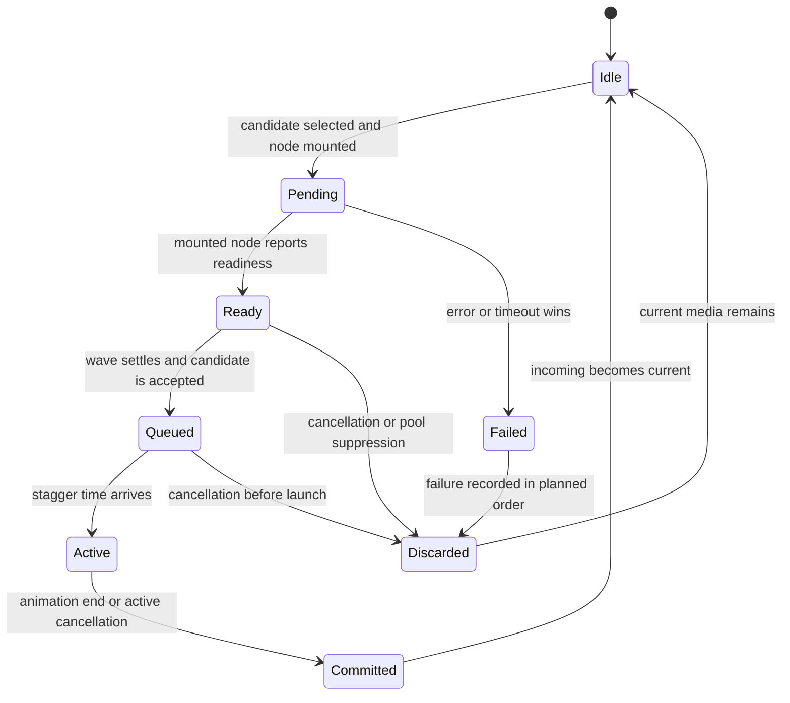
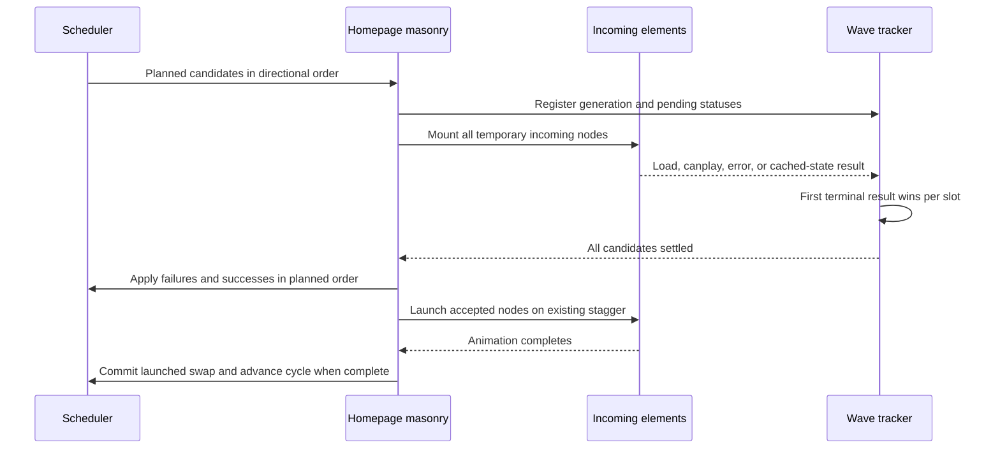

# Optimized Homepage Swap Media - Plan

## Goal Capsule

- **Objective:** Homepage visitors see the existing editorial swap experience without raw source-image transfers or duplicate media requests competing for bandwidth.
- **Means:** Prepare each swap through the temporary rendered media element that will participate in the transition (KTD1-KTD3).
- **Product authority:** The Product Contract and its stable IDs govern behavior; the Planning Contract governs implementation within those constraints; current code is evidence, not authority.
- **Open blockers:** None.
- **Stop conditions:** Return to planning if the change requires altering scheduler fairness, visible transition behavior, or Cloudflare static-export policy.
- **Execution profile:** Code change with browser lifecycle coverage and built-server network verification.
- **Finish and ship:** The implementation owner completes U1-U3, satisfies the Verification Contract, and records the production-like network result before shipping.

---

## Product Contract

### Summary

Homepage swap candidates will load through stable temporary transition nodes that own readiness from mount through staggered launch.
Idle cards will render no incoming duplicate, while the scheduler, visible transition behavior, cancellation, failure recovery, responsive topology, and accessibility rules remain intact.

### Problem Frame

The current homepage prepares still-image swaps with detached browser images pointed at original uploads, then mounts a responsive `next/image` layer for the transition.
The first audited wave transferred 16.9 MB of raw originals before requesting about 22 KB of optimized images, and three repeated waves transferred 67.8 MB across 12 raw requests.
Video candidates follow the same duplicate-element pattern, while idle first-row cards already retain a hidden incoming copy of their current media.
This wastes bandwidth and decode work on a photography-led portfolio where performance is part of the product experience.

### Key Decisions

- **Address homepage swap delivery first.** (session-settled: user-directed — chosen over issues #29 through #32: it removes the largest measured waste and unblocks later video-delivery and deployment-policy work.) Governs R1-R11.
- **Preserve the editorial experience while changing media preparation.** Performance work must not alter the visible cadence, ordering, motion, or card interaction. Governs R5-R7.
- **Treat the rendered incoming layer as the readiness authority.** Detached preparation cannot prove that the element used in the transition is ready. Governs R1-R4.
- **Keep static-export policy separate.** This work targets the production server path; Cloudflare Drop support remains issue #32. Governs R9.

### Requirements

**Media preparation and ownership**

- R1. Each successful stable-source incoming still image must be requested through exactly one connected owner: its responsive optimized rendered transition layer.
- R2. Homepage still-image swap preparation must make no browser request directly to an original image file endpoint.
- R3. Each incoming video must report readiness from its mounted transition element without a second detached media request.
- R4. An idle card must not retain a hidden incoming copy of its current media.

**Transition lifecycle**

- R5. A wave may enter its staggered transition only after every participating incoming element is ready to render.
- R6. The initial six-second delay, later cycle delay, directional ordering, and stagger timing must remain unchanged.
- R7. Scrolling away, hiding the document, enabling reduced motion, or changing responsive topology must cancel pending preparation and ignore stale readiness callbacks.
- R8. A timeout or failed media request must preserve scheduler progress and avoid stalled waves or unbounded retries.

**Compatibility and verification**

- R9. The production server deployment must remain the performance baseline, with Cloudflare static-export policy and responsive static derivatives excluded from this work.
- R10. Browser coverage must exercise still-image readiness, video readiness, timeout and failure recovery, cancellation, topology changes, document visibility changes, and restart behavior.
- R11. A production-like network check across at least three swap waves must report zero transferred bytes from raw image-original requests.

### Key Flows

- F1. Prepare and run a swap wave
  - **Trigger:** An eligible homepage wave reaches its scheduled delay.
  - **Steps:** Select candidates, mount one temporary incoming layer per participating card, wait for those layers to report readiness, then launch the existing staggered transition.
  - **Outcome:** The prepared media becomes current after the transition, and each card returns to an idle state with one rendered media element.
  - **Covers:** R1-R6.
- F2. Cancel pending or active work
  - **Trigger:** The homepage leaves the eligible viewport state, the document becomes hidden, reduced motion becomes active, or responsive topology changes.
  - **Steps:** Invalidate the current wave, discard prepared but unlaunched layers, settle already launched swaps through the existing commit behavior, and ignore stale callbacks.
  - **Outcome:** Prepared or queued candidates never launch or commit, already launched candidates settle exactly once, and scheduling can restart under the current eligibility state.
  - **Covers:** R4, R7.
- F3. Recover from unavailable media
  - **Trigger:** An incoming element errors or does not become ready before the preparation timeout.
  - **Steps:** Remove the failed temporary layer, record the candidate failure through the existing recovery behavior, and allow later scheduling to continue.
  - **Outcome:** The current media remains usable and future waves do not stall or retry forever.
  - **Covers:** R8.

### Acceptance Examples

- AE1. Optimized still-image preparation
  - **Covers R1, R2, R5.**
  - **Given:** A homepage card selects a valid still image for the next wave.
  - **When:** The browser prepares that candidate.
  - **Then:** The mounted incoming image is the only connected request owner, it requests a responsive optimized rendition, no original-file preparation request is made, and the wave waits for that image's readiness.
- AE2. Video preparation
  - **Covers R3, R5.**
  - **Given:** A homepage card selects a video for the next wave.
  - **When:** Its incoming video becomes ready to play.
  - **Then:** Readiness comes from the mounted transition video, with no detached duplicate video request.
- AE3. Idle card
  - **Covers R4.**
  - **Given:** A card is not preparing or running a swap.
  - **When:** Its rendered media is inspected.
  - **Then:** The card contains its current media and no incoming transition copy.
- AE4. Eligibility cancellation
  - **Covers R7.**
  - **Given:** A wave is preparing incoming media or has begun its staggered transition.
  - **When:** The document becomes hidden, reduced motion is enabled, the relevant cards leave the active area, or responsive topology changes.
  - **Then:** Prepared but unlaunched layers are removed, launched swaps settle once, stale callbacks have no effect, and no obsolete transition starts.
- AE5. Failed preparation
  - **Covers R8.**
  - **Given:** One incoming candidate errors or times out.
  - **When:** Preparation settles.
  - **Then:** The failed candidate does not transition, the current media remains visible, and later cycles can continue without an infinite retry.
- AE6. Production-like network verification
  - **Covers R11.**
  - **Given:** The homepage runs on the production server path with representative portfolio media.
  - **When:** At least three swap waves complete.
  - **Then:** The network log contains zero transferred bytes from raw image-original requests caused by swap preparation.

<!-- ce-section: work-relationships -->
### How This Work Fits Together

This plan covers issue #28 only; the broader breakdown is context, not a committed roadmap.

- Issue #31, offscreen video delivery
  - **Depends on:** Issue #28 establishing rendered incoming video elements as the readiness source.
- Issue #32, Cloudflare Drop export policy
  - **Depends on:** Issue #28 and issue #29 supplying verified server-path performance evidence.
- Issue #29, responsive image priority and sizing
  - **Can proceed independently of:** Issue #28.
  - **Shares:** The production image-performance goal and responsive `next/image` path.
- Issue #30, media URL versioning and cache lifetimes
  - **Can proceed independently of:** Issue #28.

### Scope Boundaries

- Offscreen video source deferral and optimized homepage posters remain in issue #31.
- Initial image priority and responsive size-hint corrections remain in issue #29.
- Media URL versioning and cache-lifetime policy remain in issue #30.
- Cloudflare Drop support, removal, and static responsive derivatives remain in issue #32.
- The visible homepage composition, transition timing, animation style, link behavior, and media selection fairness are unchanged.

### Dependencies / Assumptions

- The production deployment uses the Next.js server path with image optimization enabled.
- Existing media records provide usable original image URLs and generated video playback URLs before they enter homepage pools.
- The existing scheduler remains the authority for candidate selection, fairness, failure tracking, and cycle progression.

### Sources / Research

- GitHub issue [#28](https://github.com/slawinski/karolg/issues/28) supplies the measured baseline and acceptance boundary.
- `PRODUCT.md` defines performance, restrained motion, reduced-motion support, and responsive composition as product constraints.
- `src/components/HomepageMasonry.tsx` contains the current detached preparation, rendered media layers, eligibility gating, wave timing, and cancellation behavior.
- `src/components/HomepageMasonry.browser.test.tsx` contains the current browser lifecycle coverage and detached-video test harness.
- `src/lib/media.ts` defines original image, generated video playback, poster, readiness, and presentation URL behavior.
- `src/lib/homepage.ts` defines swap acceptance, failure tracking, and commit behavior.
- `next.config.ts` confirms that production uses the image optimizer while static export disables it.
- [Next.js Image documentation](https://nextjs.org/docs/app/api-reference/components/image#onload) defines `onLoad` as firing after the mounted image finishes loading and its placeholder is removed; `onLoadingComplete` is deprecated.

---

## Planning Contract

### Product Contract Preservation

Restructured, no scope change: R1 defines one connected owner for successful stable-source images, F2 and AE4 distinguish cancellation before and after stagger launch, and the lifecycle diagram moves into the technical design with the accepted-but-unlaunched phase made explicit.

### Key Technical Decisions

- KTD1. **The mounted incoming element owns readiness.** Next.js Image `onLoad` already waits for the framework's decode contract and ignores disconnected nodes, so a detached browser image or second component-level decode would create another owner without stronger readiness proof. Incoming videos use element-level `canplay`, error, and mounted ready-state checks. Governs R1-R5.
- KTD2. **One tracker owns wave lifecycle; React state is its rendered projection.** Scheduler state remains the sole owner of fairness and failure exclusions, while the generation-scoped wave tracker owns candidate identity, terminal status, queued or launched disposition, deadline, closure, and one-time cycle advancement. The existing pending counter, if retained, counts accepted transition participants only. This rejects React-state-only arbitration and reusing the transition counter for preparation. Governs R3-R8.
- KTD3. **Preparation and active transition are phases of one candidate identity.** A candidate identity combines its wave generation, slot, pool, and next index, while the slot remains the render lookup key. That identity stays stable through pending, ready, queued, and active phases. This rejects phase-specific keys, separate render branches, and clearing preparation before activation. Governs R1, R3-R7.
- KTD4. **Readiness is observational; one ordered finalizer mutates scheduler failure state.** Callbacks claim only the first terminal status, then an all-settled finalizer applies same-pool suppression and failure bookkeeping in planned order. Cancellation bypasses failure finalization, preserves prior cursor advances, and advances the cycle only if a transition started. This rejects fail-fast launch, callback-order processing, and scheduler rollback. Governs R5, R8.
- KTD5. **The wave tracker is the synchronous cancellation authority.** Native visibility, motion, intersection, and resize callbacks invalidate its authority before readiness can finalize; later React effects project cleanup into the DOM. Settlement, timeout, launch, and completion still check generation and current eligibility or topology. This rejects effect-only invalidation. Governs R7.
- KTD6. **Preparation loading hints apply only to temporary incoming media.** Incoming images load eagerly and incoming videos use `preload="auto"` as a fetch hint, while the wave deadline remains the progress guarantee. Metadata-only preparation may never reach `canplay`; `canplaythrough` and global eager loading would broaden bandwidth use into issue #31. Governs R3, R5, R9.
- KTD7. **Browser lifecycle proof and production delivery proof remain separate.** The Vitest image shim verifies connected-node orchestration, while the normal built server verifies optimized request ownership and zero raw-original swap transfer. Governs R1, R2, R10, R11.

### High-Level Technical Design

Each candidate moves through one rendered lifecycle. `Pending`, `Ready`, and `Queued` remain preparation phases, so the underlying image or video node survives until launch or discard.

The wave gate separates event arrival from ordered scheduling decisions:

### Implementation Constraints

- Keep candidate selection, fairness, failure exclusions, and index commits in `src/lib/homepage.ts`; DOM readiness remains in `src/components/HomepageMasonry.tsx`.
- Keep scheduler state, wave lifecycle authority, and React render state as separate owners per KTD2.
- Preserve the existing 6000 ms initial delay, 7000 ms later delay, 5000 ms preparation deadline, 240 ms stagger, and 1500 ms transition.
- Preserve directional order and finalize failures in planned order rather than callback order.
- Start one generation-scoped preparation deadline when a wave's incoming nodes are published.
- Treat the first readiness, failure, or timeout result for a candidate as terminal.
- Keep current videos active during preparation and keep incoming videos paused.
- Do not modify transition CSS, responsive breakpoints, optimizer configuration, Payload media schemas, or static-export scripts.

### Risks and Mitigations

- **Node remount during stagger:** A phase-specific key or mutually exclusive render branch could replace a prepared node; enforce KTD3 through one incoming render path.
- **Same-turn cancellation race:** React effects can trail native eligibility or topology events; enforce KTD5 before a readiness callback can open the wave gate.
- **False preparation timeout:** Browser preload behavior is advisory; use the scoped hints in KTD6 and keep the wave deadline authoritative.
- **Callback-order regression:** Concurrent media events could change same-pool fairness; enforce KTD4 so callbacks never mutate scheduler failures directly.
- **False optimizer confidence:** The browser test shim renders a plain image; require normal-server network evidence for R1, R2, and R11.

---

## Implementation Units

### U1. Make rendered media report preparation readiness

**Goal:** Give temporary incoming images and videos a shared readiness and failure contract without creating detached request owners.

**Requirements:** R1-R5, R9; F1; AE1-AE3.

**Dependencies:** None.

**Files:**

- `src/components/HomepageMasonry.tsx`
- `src/components/HomepageMasonry.browser.test.tsx`

**Approach:**

1. Extend the existing homepage media rendering boundary with optional preparation readiness and failure notifications.
2. Route still images through the Next.js Image load and error contract without adding another decode or browser image object.
3. Route videos through mounted `canplay` and error events plus a ready-state fallback for cached media.
4. Apply eager image loading and stronger video preload only while media is an incoming preparation participant.
5. Preserve cadence, fairness, and cancellation characterization coverage so U2 can migrate the wave without losing regression protection.

**Execution note:** Establish the characterization baseline before U2 removes detached preparation; add direct mounted-media callback coverage alongside the readiness boundary.

**Patterns to follow:** Keep playback eligibility separate from readiness as `HomepageVideo` does today, preserve the full-card link stacking, and retain `mediaPresentationUrl` as the source authority.

**Test scenarios:**

- Covers AE1. A connected incoming image reports ready on load, reports failed on error, and creates no detached browser image.
- Covers AE2. A connected incoming video reports ready on `canplay`, remains paused, and creates no disconnected sourced video.
- A cached incoming video with enough future data settles ready from its mounted state even when no later `canplay` event arrives.
- A video event, ready-state check, error, and timeout racing for one slot produce one terminal result.
- Loading hints are stronger only for incoming preparation media; current media retains its prior policy.

**Verification:** The rendered-media boundary reports readiness and failure from connected nodes, and existing wave characterization still passes before its U2 migration.

### U2. Replace detached wave preparation with a mounted lifecycle

**Goal:** Publish all selected candidates as stable temporary nodes, finalize the wave once in planned order, and preserve current cancellation and scheduler semantics.

**Requirements:** R4-R8; F1-F3; AE3-AE5.

**Dependencies:** U1.

**Files:**

- `src/components/HomepageMasonry.tsx`
- `src/components/HomepageMasonry.browser.test.tsx`
- `src/lib/media.ts`
- `src/lib/media.test.ts`

**Approach:**

1. Add slot-keyed rendered preparation state as the DOM projection of the generation-scoped lifecycle authority in KTD2.
2. Publish the tracker before mounting candidates so cached readiness cannot arrive before registration.
3. Wait for every candidate to settle or reach the single wave deadline, then run the KTD4 finalizer once.
4. Keep accepted candidates mounted in a queued phase and promote each KTD3 identity to active on the existing stagger.
5. Centralize cleanup around KTD5 so preparation cancellation discards queued nodes, active cancellation commits launched swaps once, and stale callbacks lose authority immediately.
6. Leave scheduler cursor advances intact on preparation failure or cancellation, while prop-level topology replacement retains its existing full reset.
7. Remove the detached-preload helper after migrating its live wave caller, then remove its unused media-kind readiness abstraction and corresponding tests.

**Patterns to follow:** Reuse generation invalidation, `recordFailedCandidate`, `clearFailedCandidates`, `commitActiveSwap`, and `settleActiveWave` semantics instead of moving DOM phases into the pure scheduler.

**Test scenarios:**

- Covers F1. All planned incoming nodes mount before readiness, the gate stays closed until the final status settles, and launch order follows the selected wave direction rather than event order.
- Covers AE3. No incoming node exists before preparation or after normal commit, failure, cancellation, or restart.
- The same DOM node remains mounted from pending through ready, queued, and active phases.
- Covers AE5. Partial failures preserve planned-order same-pool suppression, leave failed cards on current media, and allow successful cards to transition.
- An all-failed or all-timeout wave launches nothing, removes every incoming node, advances the cycle once, and allows a later wave to recover.
- Preparation cancellation records no media failure, commits no queued candidate, preserves cursor progress, and requires a fresh full delay after eligibility returns.
- Cancellation during stagger commits launched swaps once, discards queued swaps, cancels later launches, and advances the cycle once.
- Document hiding or responsive change racing with the final readiness callback cannot start an obsolete transition.

**Verification:** The mounted lifecycle preserves exact timing and fairness, every terminal path returns cards to one current media element, and obsolete detached-readiness helpers have no callers.

### U3. Rebuild browser coverage around connected media nodes

**Goal:** Replace detached-preload test controls with deterministic connected-element lifecycle proof in Chromium and WebKit.

**Requirements:** R1-R10; F1-F3; AE1-AE5.

**Dependencies:** U1, U2.

**Files:**

- `src/components/HomepageMasonry.browser.test.tsx`

**Approach:**

1. Remove detached video preload queues as the positive readiness driver while retaining negative assertions against disconnected preparation.
2. Drive load, `canplay`, error, visibility, topology, and animation events on the exact mounted incoming nodes.
3. Preserve existing cadence, directional stagger, reduced-motion, breakpoint, full-card link, and restart assertions.
4. Add node-identity, idle-cleanup, all-settled gate, partial-failure, all-failure, cached-video, timeout-race, document-visibility, and cancellation-phase coverage.
5. Keep optimizer delivery assertions out of the shimmed suite and bind them to the built-server check in the Verification Contract.

**Execution note:** Expand the characterization coverage established in U1 and migrated with U2 into the complete connected-node regression matrix.

**Patterns to follow:** Continue using fake timers for exact cadence and the existing observer stubs for visibility and responsive lifecycle control.

**Test scenarios:**

- Covers AE1 and AE2. Positive readiness is dispatched on connected incoming images and videos, with explicit negative assertions for detached request owners.
- Covers AE4. Preparation, stagger, and animation cancellation each produce their distinct commit-or-discard result and reject stale callbacks.
- Resolve participants in reverse event order and confirm launch still follows left-to-right, right-to-left, or middle-out order at 240 ms intervals.
- Fire readiness at the 5000 ms deadline and a late event afterward; one terminal status, finalization, and cycle transition occurs.
- Change from five columns to two during preparation and stagger; former top-row candidates disappear and new scheduling waits a fresh delay.
- After every success, failure, timeout, and cancellation path, idle cards contain no incoming duplicate.

**Verification:** The focused lifecycle suite passes in Chromium and WebKit without relying on Next.js optimizer behavior that the test shim cannot reproduce.

---

## Verification Contract

| Gate | Command or evidence | Proves |
|---|---|---|
| Focused pure tests | `pnpm test -- src/lib/homepage.test.ts src/lib/media.test.ts` | Scheduler invariants remain intact and obsolete media readiness helpers are removed cleanly. |
| Focused Chromium lifecycle | `pnpm test:browser -- src/components/HomepageMasonry.browser.test.tsx` | Connected-node readiness, timing, ordering, recovery, cancellation, and cleanup. |
| Focused WebKit lifecycle | `pnpm test:browser:webkit -- src/components/HomepageMasonry.browser.test.tsx` | The same lifecycle contract across the second supported browser engine. |
| Static analysis | `pnpm typecheck` | Component event, ref, state, and media contracts remain type-safe. |
| Full repository tests | `pnpm test && pnpm test:browser && pnpm test:browser:webkit` | No regression outside the focused files. |
| Build gates | `pnpm exec payload migrate`, `pnpm build`, and `pnpm build:drop` | Server and retained static-export builds still complete without changing export policy. |
| Production-like network acceptance | Run the normal built server with cache disabled, keep the homepage eligible through at least three completed waves, and preserve the network log. | Swap preparation transfers zero bytes from raw image-original endpoints; incoming stills are owned by optimized `/_next/image` requests; each prepared video is owned by its connected incoming element; current video sources do not restart during preparation. |

The built-server trace is the acceptance authority for R1, R2, and R11 because `vitest.browser.config.ts` aliases `next/image` to a plain test image.

---

## Definition of Done

- U1 is complete when rendered images and videos expose mounted-element readiness, loading hints are scoped to preparation, and existing wave characterization remains intact for migration.
- U2 is complete when detached request owners are removed and the stable preparation lifecycle preserves planned order, fairness, exact timing, node identity, and phase-specific cancellation semantics.
- U3 is complete when Chromium and WebKit cover connected readiness, failures, cached media, races, topology changes, cancellation phases, and terminal cleanup.
- Every R-ID and behaviorally material F-ID and AE-ID is covered by an implementation unit or Verification Contract gate.
- The focused and full repository gates pass, including both browser engines, type checking, migrations, server build, and static-export build.
- A production-like trace across at least three waves records zero raw image-original bytes caused by swap preparation.
- The final diff contains no abandoned preparation states, obsolete detached preload helpers, stale test harness controls, debug logging, or dead-end experimental code.
