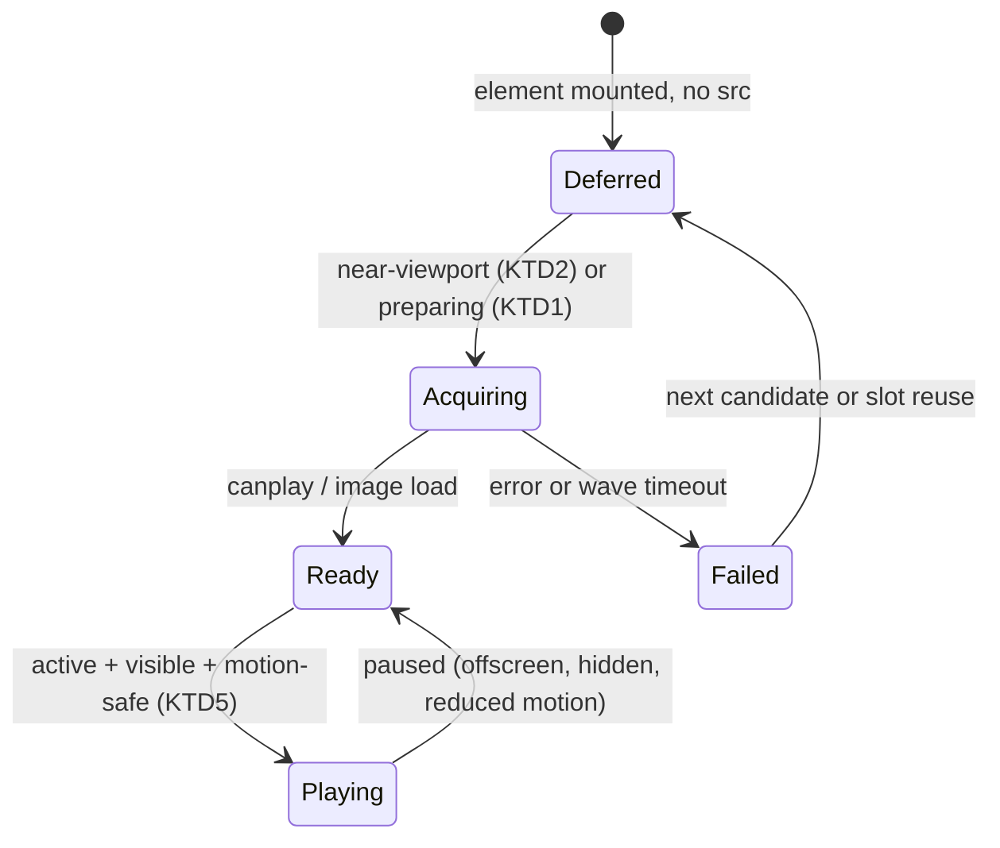

# Defer Offscreen Video Delivery and Optimize Homepage Posters - Plan

## Goal Capsule

- **Objective:** Portfolio visitors on constrained networks see the opening images load without competing for bandwidth with video that is nowhere near the screen.
- **Means:** Gate video playback-source acquisition on viewport proximity and swap preparation, and deliver homepage video posters through the responsive optimized image path (KTD1-KTD4).
- **Product authority:** GitHub issue #31 and this Product Contract govern behavior; the current code is evidence of the starting point, not authority.
- **Execution profile:** Establish gating and poster behavior in the component tests first, then prove initial-document delivery and request absence in a production build with the network-verification script.
- **Open blockers:** None.
- **Stop conditions:** Stop if the change requires altering swap scheduling fairness, visible transition timing, or video derivative generation. Report `settled-decision-invalidated` with the decision and evidence rather than relaxing a Product Contract requirement.
- **Who finishes and ships:** `ce-work` implements the units; LFG commits, opens the PR, and watches CI.
- **Surrounding work not in scope:** issue #29's residual verification and photoshoot poster optimization are context, not active scope (see How This Work Fits Together).

---

## Product Contract

### Summary

Homepage and photoshoot videos acquire playback data only when they approach the viewport or are being prepared as an incoming swap, and homepage video posters move onto the responsive optimized image path instead of eager full-size JPEGs.

### Problem Frame

Videos currently set their playback `src` and `preload="metadata"` as soon as they render, whether or not they are near the screen, and every homepage video slot carries a full-size JPEG `poster` the browser fetches eagerly. On mobile, that offscreen video and poster work competes for bandwidth with the opening portfolio images — the requests that decide how fast the page feels. Issue #28 measured the same class of waste for still swaps (16.9 MB of raw originals before ~22 KB of optimized images) and explicitly left video deferral and poster optimization to this issue.

### Requirements

**Video delivery gating**
- R1. Homepage and photoshoot videos do not request playback data until they approach the viewport or are being prepared as an incoming swap candidate.
- R2. A visible, active homepage video begins acquiring its playback source early enough to preserve the current autoplay experience.
- R3. Incoming homepage swap videos prepare and report readiness without waiting for ordinary viewport activation.
- R4. Photoshoot videos defer offscreen network activity while retaining manual controls.

**Homepage poster delivery**
- R5. Homepage video posters are delivered through the responsive optimized image path at dimensions appropriate to the rendered card.
- R6. Initial homepage loading does not eagerly download full-size posters for every rendered video slot.

**Preserved experience**
- R7. Homepage videos remain muted, looping, inline, control-free, and non-interactive beneath their project links.
- R8. Reduced motion, document visibility, and intersection changes continue to govern playback.
- R9. Failed poster or playback requests retain the transition color or an accessible fallback rather than leaving a broken frame.

**Evidence**
- R10. Browser tests cover near-viewport activation, offscreen deferral, incoming-swap preparation, reduced motion, visibility changes, and failure fallback.
- R11. Mobile network verification confirms that offscreen video playback and unoptimized poster requests no longer compete with initial portfolio images.

### Key Decisions

- KD1. **Deferral gates the playback source, not the rendered element.** The mounted media element stays the readiness owner established by issue #28, so deferral changes when bytes are requested, not which element reports readiness. Governs R1-R4.
- KD2. **Homepage posters are delivered as a responsive optimized image layer, not the raw `<video poster>` attribute.** The attribute cannot carry a responsive `srcset`, so it cannot satisfy R5 or R6. Governs R5, R6, R9.
- KD3. **Photoshoot video posters stay on their current delivery path.** Only offscreen playback deferral applies to photoshoot videos. Governs R4.
- KD4. **Poster optimization is in scope, not deferred.** The acceptance criteria require the optimized poster path; dropping it would leave R5 and R6 unmet. Governs R5, R6.

### Key Flows

- F1. Visible homepage video activation
  - **Trigger:** An active homepage video approaches the viewport.
  - **Steps:** The slot becomes near-viewport, its playback source is acquired, and playback starts under the existing visibility, motion, and page-state gates.
  - **Covers R1, R2, R8.**
- F2. Offscreen homepage video stays dormant
  - **Trigger:** A homepage video slot renders outside the activation threshold and is not a swap candidate.
  - **Steps:** No playback source is requested and the optimized poster remains the visible surface.
  - **Covers R1, R6, R7.**
- F3. Incoming swap preparation
  - **Trigger:** A wave selects a video as an incoming candidate.
  - **Steps:** The incoming element acquires its source and reports readiness through the existing preparation path, independent of ordinary viewport activation.
  - **Covers R1, R3.**
- F4. Photoshoot offscreen video deferral
  - **Trigger:** A photoshoot gallery renders a video outside the viewport.
  - **Steps:** The video keeps its controls and poster but requests no playback data until it approaches the viewport.
  - **Covers R1, R4.**

### Acceptance Examples

- AE1. Near-viewport activation
  - **Covers R1, R2.**
  - **Given:** A homepage video slot that has not requested playback data.
  - **When:** It approaches the viewport.
  - **Then:** It acquires its playback source and a visible active video still autoplays as it does today.
- AE2. Offscreen deferral
  - **Covers R1, R6.**
  - **Given:** A homepage whose video slots are below the fold.
  - **When:** The initial page loads.
  - **Then:** No offscreen playback source is requested and no full-size poster is fetched for the offscreen slots.
- AE3. Incoming-swap preparation
  - **Covers R3.**
  - **Given:** A swap wave whose incoming media is a video.
  - **When:** The wave prepares.
  - **Then:** The incoming element reports readiness without waiting for ordinary viewport activation, and the transition does not start before it is ready.
- AE4. Reduced motion and visibility
  - **Covers R8.**
  - **Given:** Reduced motion is on, or the document is hidden.
  - **When:** A near-viewport video becomes eligible.
  - **Then:** Playback does not start, and visibility changes continue to pause and resume as they do today.
- AE5. Failure fallback
  - **Covers R9.**
  - **Given:** A poster or playback request fails.
  - **When:** The slot renders.
  - **Then:** The transition color or accessible fallback shows instead of a broken frame.

### Success Criteria

- Browser tests pass for near-viewport activation, offscreen deferral, incoming-swap preparation, reduced motion, visibility changes, and failure fallback (R10).
- Mobile network verification shows initial portfolio images loading without offscreen video playback or full-size poster requests competing for bandwidth (R11).

### How This Work Fits Together

<!-- ce-section: work-relationships -->

This plan covers issue #31 only; the broader breakdown is the current understanding, not a committed roadmap.

- Offscreen video deferral and optimized homepage posters (this plan)
  - **Depends on:** Issue #28's rendered-element readiness ownership (closed via PR #33).
- Issue #29, responsive image priority and sizing
  - **Delivered by:** PR #34; the issue stays open pending a WebKit CI verification obligation.
  - **Shares:** The production image-performance goal and the responsive `next/image` path.
  - **Can proceed independently of:** Issue #31.
- Photoshoot poster optimization
  - **Still to decide:** whether it is worth a follow-up once homepage poster delivery lands.

### Scope Boundaries

- Deferred for later: photoshoot video poster optimization, and WebKit CI parity for the opening-image work.
- Outside this work: the retired Cloudflare Drop static-export path, and any change to video encoding or derivative generation.

### Dependencies / Assumptions

- Production serves images through the Next.js optimizer — `next.config.ts` enables avif/webp formats. Verified this run.
- Issue #28's mounted-element readiness ownership and swap scheduling are preserved unchanged.
- Video records carry published playback and poster derivatives before they enter homepage pools.

### Outstanding Questions

- Deferred to Planning: the near-viewport activation threshold, and whether the initially visible active video counts as already near-viewport at first paint.

### Sources / Research

- GitHub issue [#31](https://github.com/slawinski/karolg/issues/31) supplies the acceptance boundary.
- `docs/plans/2026-10-16-1711-fix-homepage-swap-media-plan.md` deferred this scope here; its KTD6 warns that global eager loading or `canplaythrough` would broaden bandwidth use into this issue.
- `src/components/HomepageMasonry.tsx` holds the homepage video lifecycle and swap preparation; `src/components/Visual.tsx` holds photoshoot video rendering; `src/lib/media.ts` holds poster and playback URL helpers.
- `src/components/HomepageMasonry.browser.test.tsx` holds the existing video-lifecycle coverage to extend.

---

## Planning Contract

**Product Contract preservation:** unchanged.

### Key Technical Decisions

- KTD1. **The mounted media element owns source acquisition.** `HomepageVideo` and the photoshoot video component keep the element mounted and decide internally when to attach `src`; the wave preparation path still reports readiness from that same element. This preserves issue #28's readiness ownership (KD1) and rejects unmount-and-remount or a second detached loader. Governs R1, R3.
- KTD2. **Near-viewport activation is an IntersectionObserver with a forward margin.** A video becomes a near-viewport candidate when it enters a `rootMargin` expanded two viewport heights beyond the visible area on each side, defaulting to `200% 0px` (a percentage resolves against the root's height); preparation bypasses this gate. The margin must also treat the initially visible active video as near-viewport at first paint so R2 holds. Governs R1, R2.
- KTD3. **The homepage poster becomes a `next/image` layer.** A responsive `Image` (`fill`, `sizes` matching the masonry card) renders beneath the video and is the visible surface until playback begins; the homepage video's raw `poster` attribute is dropped. The layer is also the R9 failure surface, so the transition color and accessible fallback show through when a poster or playback request fails. Governs R5, R6, R9.
- KTD4. **Photoshoot deferral lives in its own client component.** `Visual` stays a server component; the video branch delegates to a client component that owns `src` acquisition on near-viewport entry and on an explicit play intent, keeping `controls`, `playsInline`, and the metadata poster (KD3). Governs R1, R4.
- KTD5. **Playback gates are unchanged; only acquisition timing changes.** The existing visibility, reduced-motion, intersection, and page-state effects continue to own play/pause. Governs R7, R8.

### High-Level Technical Design

Each rendered video moves through acquisition states; the element is mounted throughout, so readiness ownership never moves (KTD1).

The homepage poster layer (KTD3) is independent of this state machine: it renders whenever the slot has usable media, so a failed `Acquiring` still shows the optimized poster or transition color rather than a broken frame.

### Assumptions

- The forward `rootMargin` default (`200% 0px`) preserves the current autoplay feel; its exact value may be tuned during implementation if the production network run shows a visible delay before playback.
- The masonry poster `sizes` hint can reuse the card's existing `sizes` string, since the poster occupies the same box as the still image.
- Photoshoot playback URLs support the same byte-range behavior already relied on by the manual controls; deferral does not change the endpoint.

---

## Implementation Units

### U1. Gate homepage video playback source on viewport and preparation

- **Goal:** A mounted homepage video attaches its playback `src` only when it is near-viewport or preparing as an incoming swap, without changing the readiness path.
- **Requirements:** R1, R2, R3, R8; KD1, KTD1, KTD2, KTD5.
- **Dependencies:** None.
- **Files:** `src/components/HomepageMasonry.tsx`, `src/components/HomepageMasonry.browser.test.tsx`.
- **Approach:**
  - Add near-viewport state to `HomepageVideo` driven by an `IntersectionObserver` using the KTD2 margin, separate from the existing 0.1-ratio play/pause observer.
  - Attach `src` in the acquisition effect only when `preparing` is true or the element is near-viewport; otherwise leave `src` detached and use `preload="none"`.
  - Keep the `preparing ? 'auto' : 'metadata'` hint for an acquiring element; a deferred element requests nothing.
  - Preserve the existing unmount cleanup that pauses and clears `src`.
- **Patterns to follow:** The existing `IntersectionObserver` and visibility/motion effects in `HomepageVideo` (`src/components/HomepageMasonry.tsx:105-162`).
- **Test scenarios:**
  - `Covers AE1.` A deferred video reports no `src` request until the near-viewport callback fires, then acquires one.
  - `Covers AE2.` An offscreen video renders with no `src` and no request after the initial mount.
  - `Covers AE3.` A preparing incoming video acquires `src` while offscreen and reports readiness without a near-viewport callback.
  - `Covers AE4.` A near-viewport element under reduced motion or a hidden document acquires its source but does not play.
  - Edge case: an element already in the viewport at mount acquires its source on the first observer callback rather than waiting for a scroll.
- **Verification:** The extended browser test file passes, and a deferred slot never sets `src` in the test harness's request log until activation.

### U2. Deliver homepage video posters through the optimized image layer

- **Goal:** Homepage video slots show a responsive optimized poster image instead of an eager full-size JPEG, and that image is the failure fallback.
- **Requirements:** R5, R6, R7, R9; KD2, KTD3.
- **Dependencies:** U1.
- **Files:** `src/components/HomepageMasonry.tsx`, `src/app/(frontend)/styles.css`, `next.config.ts`, `src/components/HomepageMasonry.browser.test.tsx`.
- **Approach:**
  - Extend `next.config.ts` `images.localPatterns` (currently only `/api/media/file/**` and `/media/**`) to allow the published video poster endpoint `/api/media/*/poster`. A published video's poster URL is `/api/media/<id>/poster?v=<rev>`, which the current patterns reject, so the optimizer would refuse it and R5/R6 fail.
  - Render a `next/image` layer in the video slot using `mediaPosterUrl` as its source, `fill`, the card `sizes` string, and `loading`/`fetchPriority` matching the slot's existing still-image rules (eager only for the initial visible slots). Give the layer its own class (e.g. `gallery-stage__poster`) so the `.gallery-stage__outgoing`/`.gallery-stage__incoming` selectors still target the media element.
  - Drop the raw `poster` attribute from the homepage `<video>`; keep the poster image layer mounted beneath it and visible until playback starts.
  - Mark the layer decorative (`alt=""`, `aria-hidden`) because the `<video>` already carries the card's accessible label, and keep the layer as the visible surface when a poster or playback request fails while the label stays on the video.
  - The layer carries a dedicated class (`media-poster`) in both the `.gallery-stage` swap path and the non-first-row `gallery-static-image` path, so it does not collide with the media-element selectors and works where no `.gallery-stage__color` layer exists.
- **Patterns to follow:** The still-image `Image` branch in `HomepageVisual` (`src/components/HomepageMasonry.tsx:225-239`) and the `.gallery-stage__color` layering in `src/app/(frontend)/styles.css`.
- **Test scenarios:**
  - `Covers AE2.` An offscreen video slot renders an optimized poster `Image` and no raw `poster` attribute.
  - `Covers AE5.` A playback `error` leaves the optimized poster layer visible over the transition color.
  - Happy path: an eager opening video slot's poster is eager with intentional priority; later slots stay lazy.
- **Verification:** The slot markup carries an `img` poster layer with a `sizes` hint and no `poster=` attribute on the video; the poster URL (`/api/media/<id>/poster?v=<rev>`) is accepted by the configured image patterns rather than raising an "Invalid src prop" error; the browser test file passes.

### U3. Defer photoshoot gallery video network activity

- **Goal:** Photoshoot gallery videos request no playback data while offscreen and still present manual controls when reached.
- **Requirements:** R1, R4; KD3, KTD4.
- **Dependencies:** None.
- **Files:** `src/components/Visual.tsx`, `src/components/PhotoshootVideo.tsx` (new), `src/components/Visual.test.tsx`, `src/app/(frontend)/work/[slug]/page.tsx`, `src/components/PhotoshootGallery.browser.test.tsx`.
- **Approach:**
  - Add a client component that renders the `<video controls playsInline preload="none">` with the metadata poster and attaches `src` on near-viewport entry, with a host-level `onPointerDown`/`onFocus` handler as the explicit acquisition trigger (native control events do not reach the host while `src` is detached, so an overlay or host handler is required for pointer and keyboard users).
  - Delegate the video branch of `Visual` to that component, keeping `Visual` a server component and leaving the image branch untouched.
  - Keep the existing `controls`, `playsInline`, `preload="metadata"`, and no-`autoPlay` behavior once the source is attached.
  - Re-express `src/components/Visual.test.tsx`'s ready-video `preload="metadata"` and no-`` assertions for the deferred SSR state (no `src`, `preload="none"`); the native poster fallback stays.
- **Patterns to follow:** The existing photoshoot video markup in `src/components/Visual.tsx:37-51` and the video assertions in `src/components/PhotoshootGallery.browser.test.tsx:62-68`.
- **Test scenarios:**
  - `Covers F4.` A photoshoot video offscreen requests nothing until it enters the near-viewport margin, then acquires `src`.
  - `Covers F4.` An offscreen photoshoot video never acquires a source as the page loads.
  - Edge case: an explicit play/pointer intent acquires the source even before the viewport callback.
  - Happy path: once acquiring, the element keeps `controls`, `playsInline`, and does not autoplay.
- **Verification:** The photoshoot browser test file passes, and no offscreen gallery video appears in the harness request log before activation.

### U4. Extend browser coverage for deferral and failure behavior

- **Goal:** The repository proves near-viewport activation, offscreen deferral, incoming-swap preparation, reduced motion, visibility, and failure fallback in browser-level tests.
- **Requirements:** R10; KD1-KD4; KTD1-KTD5.
- **Dependencies:** U1, U2, U3.
- **Files:** `src/components/HomepageMasonry.browser.test.tsx`, `src/components/PhotoshootGallery.browser.test.tsx`, `src/components/PhotoshootVideo.browser.test.tsx` (new).
- **Approach:**
  - Extend the existing harness that overrides `document.createElement('video')` and records requested sources (`HomepageMasonry.browser.test.tsx:17,212`) so a deferred element's request log is asserted empty.
  - Add the near-viewport and preparation transitions, reduced-motion and visibility gates, and the failure fallback from the unit scenarios above.
  - Re-express the existing `preload === 'metadata'` assertion (`HomepageMasonry.browser.test.tsx:440`) as acquiring-versus-deferred semantics: `'none'` while deferred, `'metadata'` or `'auto'` once acquiring. Update the one-media-per-card topology assertions (`expectIdleCards`, `HomepageMasonry.browser.test.tsx:37-43`) and the `.gallery-stage__outgoing`/`.gallery-stage__incoming` selectors for video slots, which now hold a poster `img` plus the `<video>`; keep the remaining lifecycle and cancellation assertions as regression coverage.
- **Test scenarios:**
  - `Covers AE2, AE3.` A deferred slot's request log stays empty until activation while the preparing slot's log is populated offscreen.
  - `Covers AE4.` Reduced-motion and hidden-document cases acquire but do not play.
  - `Covers AE5.` A failed poster or playback request shows the transition color or poster fallback.
- **Verification:** `pnpm test:browser` passes with the new cases and no weakening of the existing lifecycle and cancellation assertions.

### U5. Record mobile network verification of the deferral and poster path

- **Goal:** Production evidence shows the initial homepage load requests none of the offscreen video playback sources and no full-size video posters.
- **Requirements:** R11, R5, R6; KD2, KTD3.
- **Dependencies:** U1, U2, U3.
- **Files:** `scripts/verify-homepage-video-delivery.mjs` (new), `docs/verification/` (new results file).
- **Approach:**
  - Model the script on the existing production-verification script pattern: a fresh production build served on a dedicated port, a mobile viewport with DPR 2, and a CDP request log.
  - Assert the initial document requests no playback URL for an offscreen video slot and no unoptimized poster URL, while the opening portfolio image requests and the near-viewport video acquisition are present.
  - Record the results as a committed receipt under `docs/verification/`.
- **Patterns to follow:** `scripts/verify-photoshoot-candidates.mjs` and `docs/verification/2026-10-17-photoshoot-candidates.md`.
- **Test expectation:** none — this unit produces a production network receipt, verified by re-running the script against a fresh build.
- **Verification:** The script reports zero offscreen playback and unoptimized-poster requests on the mobile row and the receipt is committed.

---

## Verification Contract

| Check | Command | Applies to | Done signal |
| --- | --- | --- | --- |
| Unit tests | `pnpm test` | All units | Suite passes with no regressions |
| Browser tests | `pnpm test:browser` | U1-U4 | Chromium suite passes with the new deferral cases |
| Typecheck | `pnpm typecheck` | All units | No type errors |
| Production build | `pnpm build` | U5 | Build succeeds |
| Mobile network verification | `pnpm build && pnpm start --port 3108` then `pnpm exec tsx scripts/verify-homepage-video-delivery.mjs` | U5 | Zero offscreen playback or unoptimized-poster requests on the mobile row |

---

## Definition of Done

- Every requirement R1-R11 is satisfied and every unit U1-U5 is implemented and verified.
- `pnpm test`, `pnpm test:browser`, `pnpm typecheck`, and `pnpm build` all pass.
- The committed network receipt shows the mobile initial load free of offscreen video playback and unoptimized poster requests.
- Homepage videos remain muted, looping, inline, control-free, and non-interactive; photoshoot videos keep manual controls.
- Reduced motion, document visibility, and intersection changes still govern playback.
- No abandoned-attempt or experimental code remains in the diff.
