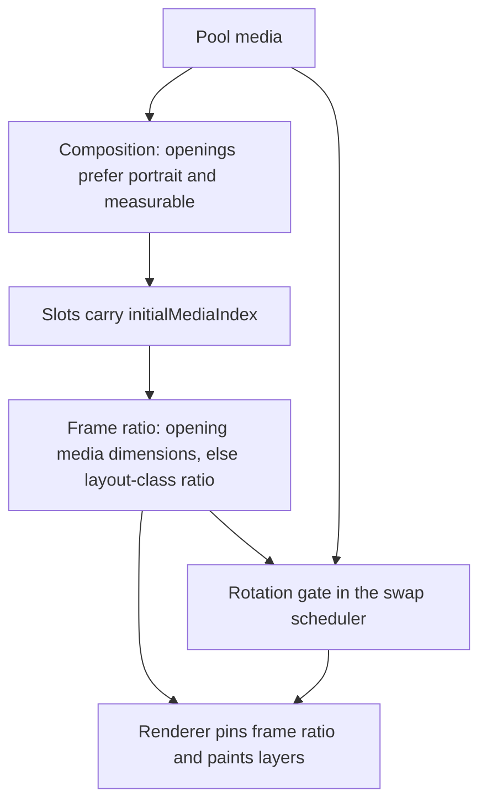
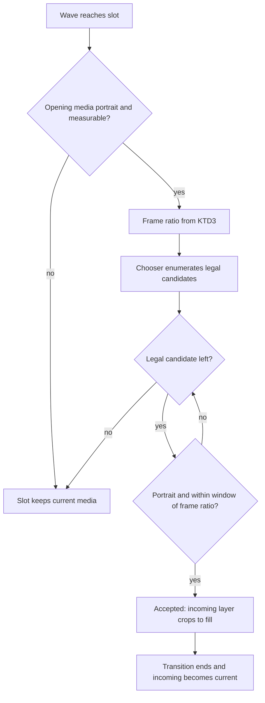

# Homepage First-Row Crop - Plan

## Goal Capsule

- **Objective:** A visitor to the homepage never sees a rotating gallery photo letterboxed inside its frame; every rotating photo fills its frame with a bounded crop, and a rotating slot with no compatible photo shows the photo it already has.
- **Means:** crop each rotating photo to fill its frame, and restrict rotation to portrait photos that sit within a ratio window of that frame (KD1, KD2).
- **Product authority:** the site owner decides crop-versus-letterbox and the width of the ratio window.
- **Execution:** code.
- **Open blockers:** none.
- **Stop conditions:** return to planning if a compliant fix would need transition-cadence, breakpoint, or project-gallery changes.

---

## Product Contract

**Product Contract preservation:** changed: `### Dependencies / Assumptions`, one deferred bullet under `### Scope Boundaries`, and `### Outstanding Questions` only — no R, KD, F, AE, Success Criterion, or Scope Boundary changed in meaning. The ±15% evidence was corrected against the real library, "photo" was fixed to mean rotating pool media (images and videos), the library counts now say which dimensions make a media measurable, that deferred bullet no longer calls containment unused, and the three items deferred to planning are answered in the Planning Contract rather than left standing.

### Summary

Rotating homepage photos stop being letterboxed and start filling their frames. To keep the crop modest, a rotating slot opens on a portrait photo and rotates only among portrait photos within a ratio window of its frame; when none qualify, the slot holds the photo it has.

### Problem Frame

The homepage gallery rotates one photo per column while the frame keeps the ratio of the photo that opened it. Every other card holds a single photo for its whole life, so its frame and its photo always agree. The rotating card is the only one where the two can disagree, and when they do the photo is fitted whole inside a frame of a different shape. The unused frame area shows the frame background colour, which reads to a visitor as a stripe down the sides or across the top and bottom of that one photo, roughly six seconds after load.

The mismatch was introduced deliberately: an earlier change pinned the frame to the opening photo to stop the layout shift that came from resizing frames mid-rotation, and the fit was switched to whole-photo containment in the same period. The result preserved the layout at the cost of the frame colour showing through, which the project's own galleries never do.

### Key Decisions

- **KD1. A rotating photo fills its frame and crops the overflow.**
  Rationale: cropping is what the project galleries already do, and the design guidance treats editorial crops as welcome. Governs R1, R3.
- **KD2. Rotation is restricted to portrait photos within a ratio window of the frame.** (session-settled: user-directed — chosen over letterboxing and over cropping with no candidate restriction: an unbounded crop would cut portraits into slivers.)
  Rationale: the window caps how much of a photo can be cropped away. Governs R5, R6, R7.

No session-settled label sits on the window's width: that number is an implementation assumption recorded under Dependencies / Assumptions, not a choice the session author reviewed.

---

### Requirements

**Frame fill**

- R1. Every rotating homepage photo fills its frame; when the photo's ratio differs from the frame's, the photo crops along the overflowing axis instead of being fitted whole.
- R2. A frame keeps the ratio of the photo that opened it, so frames never change shape mid-rotation.
- R3. No point in a rotation cycle exposes the frame background colour as a visible stripe beside, above, or below a photo.

**Rotation candidates**

- R4. A slot rotates only among photos in its own project's pool.
- R5. A candidate photo is portrait, meaning its height is strictly greater than its width.
- R6. A candidate photo's ratio sits within ±15% of its frame's ratio, measured as `|candidate − frame| / frame`. This bounds the visible crop to at most 15% of one axis:

  | Difference from the frame | Crop when the candidate is wider | Crop when the candidate is narrower |
  |---|---|---|
  | 5% | 4.8% | 5.0% |
  | 10% | 9.1% | 10.0% |
  | 15% | 13.0% | 15.0% |

- R7. When no photo in the pool satisfies R5 and R6, the slot keeps the photo it is already showing.
- R8. A photo with no recorded width or height is never a rotation candidate, because its ratio cannot be checked.

**Opening composition**

- R9. A slot that can rotate opens on a portrait photo.

---

### Key Flows

- F1. Homepage composition
  - **Trigger:** A visitor loads the homepage.
  - **Steps:** Each project pool is composed. A slot that will rotate picks its opening photo, preferring a portrait photo. Each frame takes the ratio of the photo it opened with.
  - **Outcome:** Rotating cards show crop-filled portrait photos from the first paint, and their frames are already the right shape.
  - **Covered by:** R2, R9.
- F2. Rotation swap
  - **Trigger:** A rotation wave reaches a slot.
  - **Steps:** A photo is drawn from the slot's own pool, skipping photos already shown in this pool and photos with no recorded dimensions. The draw is accepted only if the photo is portrait and its ratio sits within the window of the frame's ratio. An accepted photo replaces the frame's photo and crops to fill. A rejected draw leaves the slot on its current photo.
  - **Outcome:** Every photo shown in a rotating frame fills it.
  - **Covered by:** R1, R3, R4, R5, R6, R7, R8.

---

### Acceptance Examples

- AE1. **No compatible candidate.**
  **Covers R5, R6, R7.**
  Given a rotating slot whose frame is 2:3 and whose pool holds no portrait photo within 15% of 2:3, when a wave fires, then the slot keeps its current photo and no frame colour becomes visible.
- AE2. **Portrait opening.**
  **Covers R9.**
  Given a pool containing at least one portrait photo, when the homepage composes, then every slot that rotates opens on a portrait photo.
- AE3. **Pool with no portrait photo.**
  **Covers R7, R9.**
  Given a project whose photos are all landscape, when the homepage composes, then its slot opens on the photo it would otherwise have drawn and never rotates.
- AE4. **Unmeasurable photo.**
  **Covers R8.**
  Given a pool whose only unused photos have no recorded width and height, when a slot needs a new photo, then the slot keeps the photo it has rather than showing an unmeasurable one.
- AE5. **Natural mismatch inside a pool.**
  **Covers R1, R6.**
  Given a pool holding both a 2:3 portrait and a near-square portrait, when the near-square photo is considered for a 2:3 frame, then it is rejected and the 2:3 photo is used instead.

---

### Success Criteria

- No homepage rotation cycle at any supported breakpoint shows a frame-colour stripe beside, above, or below a rotating photo.
- The layout-shift budget recorded for the public mobile cold load still holds, because frames keep the shape they open with (R2).

---

### Scope Boundaries

- The project pages (`/work/<slug>`) already crop and are not part of this change.
- Non-goals: making every homepage card rotate; adding a visitor control for fit-versus-crop; re-drawing opening photos for cards that never rotate.
- Deferred for later: correcting the stale "retaining object-fit crops" line in `docs/verification/public-mobile-cold-load.md`.
- Deferred for later: pruning containment declarations once no layer depends on them.

---

### Dependencies / Assumptions

- The ratio window is ±15% relative difference against the frame's ratio (R6). No number was chosen in the session that produced this plan, so the value is an implementation assumption and free to move.
- ±15% is load-bearing rather than inert: the library holds a pool that mixes 2:3 stills with 9:16 videos, 15.625% apart, so ±15% excludes those videos while ±25% would admit them.
- Portrait means height strictly greater than width (R5).
- "Photo" in R1-R9 reads as any rotating pool media, image or video; videos already rotate, and excluding them would remove existing behaviour.
- A frame with no recorded dimensions falls back to the ratio of its layout class, and the window is measured against that.
- Frames already take their ratio from the opening photo, and it is that behaviour R2 preserves.
- The rotating row is chosen at runtime from the column count, so "rotating slot" in R9 and F1 is resolved at runtime rather than fixed at a breakpoint.
- In the current library (`data/karolg.db`, 62 media rows, every one measurable: 60 images by width and height, 2 videos by video dimensions), 56 media are portrait and 52 sit at exactly 2:3; the rest are near-square portraits (≈0.985), near-square landscape (≈1.015), one at ≈0.563 and one at 1.5. Most pools are ratio-consistent, so the window usually binds softly; the mixed pool above is where it decides behaviour.

---

### Sources / Research

- `src/components/HomepageMasonry.tsx:750` takes each frame's ratio from the slot's opening media and `:761-763` applies it, while the displayed photo comes from `currentMedia` at `:730-733`. The mismatch lives between those two.
- `src/app/(frontend)/styles.css:79-83` fits homepage gallery images whole; `:74` does the same for the poster; the frame colour that shows through is set at `:49` and `:62`.
- The regression has two commits: `8ec5160` (fit changed from crop to contain, frames given fixed ratio) and `6be8880` (frame ratio repinned from the current photo to the opening photo).
- Both current behaviours are pinned by browser tests: `src/components/HomepageMasonry.browser.test.tsx:324` asserts container fit at `:366-367` and `:551-552`, and `:238` asserts a slot's frame geometry survives a swap that changes the media ratio at `:245`. The first must change with R1; the second should still pass.
- `src/lib/homepage.ts:223-272` chooses the next photo with bounds, diversity, and exclusion filters only; `:194-198` seeds pools; `:412-424` and `:431-461` decide which slots form the rotating row, which is why R9 is a runtime condition.
- `src/lib/media.ts:149-154` accepts media without consulting orientation, and `:156-169` returns nothing when width or height is missing — the source of R8.
- The project galleries already do what R1 asks: `src/app/(frontend)/work/[slug]/page.tsx:60-61` with `src/app/(frontend)/styles.css:432-438` and the cover fit at `src/components/Visual.tsx:60`.
- `docs/verification/public-mobile-cold-load.md:81-86` records the pinned-ratio decision and the layout-shift budget this plan must not regress. Its claim that the change retained "object-fit crops" is stale: the code it describes fits photos whole.
- Design intent supports both decisions: `DESIGN.md:134` prefers original crops over decorative masks, `:139` welcomes editorial crops, `:200` anticipates swipeable reels, and `.impeccable/surfaces/src-app-frontend-page-tsx.md:67` and `:120` ask for aggressive crops in swipeable sequences.

---

## Planning Contract

### Key Technical Decisions

- KTD1. **Rotating layers crop to fill; every other layer keeps whole-photo fit.** Split the shared containment rule at `src/app/(frontend)/styles.css:79-86` so `.gallery-stage__outgoing` and `.gallery-stage__incoming` take `cover`, while `.gallery-static-image` keeps `contain` because a static frame already matches its own media. (session-settled: user-directed — derives from KD1; chosen over keeping every layer contained and over removing containment everywhere: the project galleries already crop.) Governs R1, R3.
- KTD2. **The candidate window is a predicate inside the swap selection step, not a pool filter.** Pool composition stays untouched, and the pure chooser gains an optional accept predicate applied to the candidates it already enumerates, so fairness, diversity, and failure-exclusion semantics are unchanged. Filtering at pool composition was rejected because pools are also the render lookup and would lose rotation entirely when a pool holds no early candidate. (session-settled: user-directed — derives from KD2; chosen over filtering pools at composition: one owner keeps fairness, diversity, and failure exclusion intact.) Governs R4-R8.
- KTD3. **One frame-ratio owner serves both the renderer and the scheduler.** A single `homepageFrameRatio` derives the frame from the slot's opening media, falling back to the slot's layout-class ratio, and the seven-class ratio table moves into `src/lib/homepage.ts` beside it. Two independent derivations were rejected: a renderer-only helper leaves the scheduler guessing the frame it must measure against. Governs R2, R6.
- KTD4. **The window is measured against the frame, never against the previous photo.** Because R2 pins the frame to the opening media, measuring against the frame cannot compound crop across successive swaps; measuring against the currently displayed photo would let a chain of small differences drift far outside the window. Governs R6.
- KTD5. **Opening preference is applied to every slot at composition, and only a slot that opened on portrait, measurable media rotates.** Which slot rotates depends on the runtime column count, so biasing only the first slot of a pool cannot guarantee R9; a pool's openings are drawn from its portrait, measurable media first, and the rotation gate refuses any slot whose opening is not one of those. Relying on the candidate window alone would not hold R9: a near-square frame (≈1.015) admits a near-square portrait (≈0.985) at about 3%, so the slot could rotate after opening on a non-portrait photo. Governs R9.

### High-Level Technical Design

A pool's media feed three seams. Composition picks openings, the scheduler decides whether a swap happens, and the renderer pins frames and paints layers.

The rotation gate is the only place a swap is accepted or refused:

### Implementation Constraints

- Keep candidate selection, fairness, failure exclusions, and index commits in `src/lib/homepage.ts`; keep DOM rendering in `src/components/HomepageMasonry.tsx`.
- Keep the fit change in CSS; do not add component-level fit branches.
- Preserve the 6000 ms initial delay, 7000 ms later delay, 5000 ms preparation deadline, 240 ms stagger, and 1500 ms transition.
- Preserve the 5 / 3 / 2 column breakpoints and the `%7` card-class ratio assignment.
- One window constant shared by every pool.
- Do not change `.gallery-static-image` fit, project-gallery styling, Payload media schemas, optimizer configuration, or static-export scripts.
- Do not consolidate the ratio table in `src/lib/photoshoot-candidates.ts`; it mirrors gallery CSS for column scoring, not for frames.

### Assumptions

- The window value is the ±15% recorded in Dependencies / Assumptions; no pool has evidence requiring a different window, so variation per pool is not built.
- Frames keep opening geometry, so the change adds no layout shift by construction; U6 measures that rather than assuming it.
- The layout-class ratios in `src/lib/homepage.ts` match `.masonry-card-1` through `.masonry-card-7` in `src/app/(frontend)/styles.css` in order.
- Chromium is the reference engine for fit assertions. `pnpm test:browser:webkit` cannot start in this environment — browser session connection timeout after 60 seconds with no tests executed, reproduced 2026-10-18, and the same limitation is recorded in `docs/verification/2026-10-17-homepage-video-delivery.md:59`, `docs/verification/2026-10-17-photoshoot-candidates.md:188`, and `docs/verification/public-mobile-cold-load.md:110`. U5 attempts the WebKit suite and records the outcome rather than treating it as a passing gate.
- R9 draws openings for a whole pool, so a card that never rotates can open on a different photo than it would have. The Scope Boundary non-goal excludes re-drawing openings as an end in itself, not a change that follows from a slot's rotating identity being resolved at runtime.

### Risks and Mitigations

- **Existing fixtures cannot rotate at all.** The homepage browser fixtures are landscape-first and dimension-free, and the `pool` builder in `src/lib/homepage.test.ts:277-285` gives its media only an id and a url, so under R5/R6/R8 no candidate qualifies and the scheduler tests would either pass while proving nothing or fail where they assert rotation. Rewrite both fixture sets as portrait, ratio-consistent media and keep one deliberately ineligible fixture that asserts a slot holds its current photo.
- **The mixed pool's rotation collapses to one ratio family.** A pool pairing 2:3 stills with 9:16 videos sits 15.625% apart, so at ±15% a rotating slot draws only from the family its own frame belongs to: slots that opened on a still stop reaching the videos, and slots that opened on a video stop reaching the stills. That is the window working as specified; moving the constant is the single lever if the site owner wants that pool to keep mixing families.
- **Crop compounds across swaps.** Measuring against the displayed photo instead of the frame would drift; KTD4 and its test keep the measurement anchored.
- **Video poster letterboxes before playback.** A video candidate's poster is a separate element with its own fit; without the scoped homepage override in U5, R3 fails during video load.
- **Unmeasurable media path is defensive.** No current media lacks dimensions, so the class-ratio fallback is exercised only by tests; the plan asserts that path rather than trusting it.
- **Cold-load regression.** Frame geometry is unchanged by design, so CLS should hold; U6 is the evidence rather than the assumption.

---

## Implementation Units

### U1. Media ratio and orientation helpers

**Goal:** Expose one way to read a rotating pool item's ratio and portrait orientation, reporting nothing when its dimensions are unknown.

**Requirements:** R5, R6, R8; AE4.

**Dependencies:** None.

**Files:**

- `src/lib/media.ts`
- `src/lib/media.test.ts`

**Approach:**

1. Add a ratio helper beside `mediaDimensions` that returns width divided by height, and nothing when dimensions are unavailable.
2. Add an orientation helper that reports portrait only when height is strictly greater than width.
3. Leave `mediaDimensions` as the single owner of the video-versus-poster dimension fallback.

**Patterns to follow:** Mirror the null-on-missing shape and video-then-poster fallback of `mediaDimensions` in `src/lib/media.ts`.

**Test scenarios:**

- An image of 800x1200 reports a 2:3 ratio and counts as portrait.
- An image whose width equals its height is not portrait.
- A video reports its own dimensions when present and its poster dimensions when not.
- A video with neither, and an image with a missing or zero dimension, report no ratio and are not portrait.
- Covers AE4. A pool item without dimensions never satisfies the candidate checks in U3, which owns them.

**Verification:** Helper results match the ratio and orientation distribution read from `data/karolg.db` (52 media at exactly 2:3, 56 portrait of 62 measurable).

### U2. One frame-ratio owner for render and scheduler

**Goal:** Derive every slot's frame ratio in one place so the renderer and the swap scheduler cannot disagree about the shape being filled.

**Requirements:** R2, R6; AE5.

**Dependencies:** U1.

**Files:**

- `src/lib/homepage.ts`
- `src/lib/homepage.test.ts`
- `src/components/HomepageMasonry.tsx`

**Approach:**

1. Move the seven layout-class ratios into an exported constant in `src/lib/homepage.ts`, ordered to match `.masonry-card-1` through `.masonry-card-7`.
2. Add `homepageFrameRatio` taking the slot, the slot list, and the pool: the opening media's dimensions when measurable, otherwise the layout-class ratio for that slot.
3. Add the window test beside it: a candidate is in-window when `|candidate − frame| / frame` is within the constant.
4. Point the renderer's frame `aspectRatio` at the helper instead of reading `mediaDimensions` directly.

**Patterns to follow:** Reuse the existing class-index mapping `((slots.indexOf(slot) % 7) + 1)` in the component, and follow `src/lib/photoshoot-candidates.ts` as the precedent for a TypeScript mirror of a CSS ratio table.

**Test scenarios:**

- An opening media with dimensions yields those dimensions as the frame ratio.
- An opening media without dimensions yields the slot's layout-class ratio, and the mapping wraps after seven slots.
- A candidate exactly at the window edge is accepted and one just beyond it is refused.
- Covers AE5. A near-square portrait is refused against a 2:3 frame while the 2:3 portrait is accepted.

**Verification:** The renderer reads frame ratios only through the helper, and the exported constant order matches the CSS block it mirrors.

### U3. Restrict rotation to portrait candidates inside the window

**Goal:** Make the swap scheduler draw only media that are portrait and within the window of the slot's frame.

**Requirements:** R4, R5, R6, R7, R8, R9; F2; AE1, AE2, AE4, AE5.

**Dependencies:** U1, U2.

**Files:**

- `src/lib/homepage.ts`
- `src/lib/homepage.test.ts`

**Approach:**

1. Give the pure next-media chooser an optional accept predicate applied to the candidates it already enumerates, defaulting to accept-all so existing callers keep their behaviour.
2. Refuse the wave for a slot whose opening media is not portrait and measurable (KTD5), so a slot only rotates when R9 is satisfied whatever the frame's shape.
3. Build that predicate inside the swap scheduler from the candidate's ratio, the slot's frame ratio from KTD3, and the window constant.
4. Keep pool bounds, index exclusion, sibling diversity, and the exhausted-failure retry exactly as they are; a refused candidate must fall through to the next legal one rather than abort the wave.

**Execution note:** Establish the characterization baseline first: capture current scheduler behaviour for a mixed pool before the predicate exists, then add the predicate and confirm only the intended candidates disappear.

**Patterns to follow:** Keep the chooser pure and index-based as `selectNextMediaIndex` is today; pass behaviour in as an argument rather than importing render concerns.

**Test scenarios:**

- Covers AE1. A pool whose only unused media are landscape leaves the slot on its current media and schedules no swap.
- Covers AE4. A pool whose only unused media lack dimensions leaves the slot unchanged.
- A slot whose opening media is landscape never rotates, even where a near-square portrait candidate falls inside the window.
- A slot whose opening media lacks dimensions never rotates.
- A refused candidate inside the pool does not stop a later legal candidate in the same wave.
- A candidate 16% away from the frame is refused and a candidate 14% away is accepted.
- The frame ratio used by the predicate is the opening media's ratio, so a slot keeps the same window after several accepted swaps in a row.
- Covers AE5. A mixed 2:3 and near-square pool rotates only among the media whose ratio sits inside the window.

**Verification:** After the predicate, the cadence, ordering, fairness, failure-exclusion, and cycle-advance tests still assert the same outcomes. The `pool` fixture in `src/lib/homepage.test.ts:277-285` must be re-authored as portrait, measurable media first, because its current media carry only an id and a url and would leave every slot with no legal candidate.

### U4. Open rotating slots on portrait media

**Goal:** Fill slot openings from a pool's portrait, measurable media first, so whichever slot rotates opens on a compatible photo.

**Requirements:** R9; F1; AE2, AE3.

**Dependencies:** U1.

**Files:**

- `src/lib/homepage.ts`
- `src/lib/homepage.test.ts`

**Approach:**

1. Partition a pool's indexes into preferred (portrait and measurable) and remainder.
2. Draw the pool's slot count from the preferred partition first, then from the remainder, preserving distinctness and the existing sample size.
3. Leave a pool without preferred media on its current draw path so its openings are unchanged.

**Test scenarios:**

- Covers AE2. A pool with enough portrait media gives every slot a portrait opening.
- A pool with fewer portrait media than slots fills the rest from the remainder without repeating an index.
- Covers AE3. A pool with no portrait media produces the same openings as before the change.
- Covers AE2. A pool with fewer portrait media than slots rotates only the slots that opened from the portrait partition; the rest hold their non-portrait opening.
- A composition of mixed pools keeps every slot's opening inside its own pool.

**Verification:** Composed openings are portrait whenever the pool can supply that many, and no slot shares an index with a sibling in the same pool.

### U5. Apply the fit change to the rotating layers only

**Goal:** Rotating layers crop to fill while static homepage layers and project galleries keep whole-photo fit.

**Requirements:** R1, R3; AE1.

**Dependencies:** U2.

**Files:**

- `src/app/(frontend)/styles.css`
- `src/components/HomepageMasonry.browser.test.tsx`

**Approach:**

1. Split the shared rule at `src/app/(frontend)/styles.css:79-86` so placement stays shared and fit becomes per-layer.
2. Give `.gallery-stage__outgoing` and `.gallery-stage__incoming` `cover`.
3. Give `.gallery-stage .media-poster` `cover`, so a video candidate's poster cannot letterbox before the video paints.
4. Leave `.gallery-static-image`, `.media-poster` outside the homepage stage, and the project-gallery poster class as they are.
5. Replace the browser assertion that a rotating card fits its photo whole with an assertion that the painted media box fills the frame.

**Test expectation:** Covered by browser-level assertions; no unit test owns styling.

**Test scenarios:**

- The computed fit of a rotating outgoing and incoming layer is `cover`, and of a static layer is `contain`.
- A rotating photo whose ratio differs from its frame paints across the whole frame with no frame-colour gap on either axis.
- A rotating video candidate paints its poster across the whole frame before playback begins.
- A project-page video poster keeps its previous fit.

**Verification:** The browser suite asserts fit per layer class, and the existing swap-geometry test still passes because the frame is untouched.

### U6. Re-measure the public mobile cold load

**Goal:** Show that pinning frames to portrait openings keeps the recorded layout-shift budget.

**Requirements:** R2; Success Criteria 2.

**Dependencies:** U4, U5.

**Files:**

- `docs/verification/2026-10-18-homepage-first-row-crop.md`
- `scripts/measure-public-cold-load.mjs`

**Approach:**

1. Build and serve the public site from an isolated copy in Chromium, the engine recorded for this protocol in `docs/verification/public-mobile-cold-load.md`.
2. Measure `/` with that protocol: three cold-cache and three warm-cache runs at the recorded viewport, CPU, and network settings.
3. Record LCP, blocking time, CLS, and the shift sources in a new dated file.
4. Leave the older verification record untouched, since the plan defers correcting its stale containment claim.

**Execution note:** Prefer the recorded protocol over a lighter substitute; the point is comparability with the existing budget.

**Test expectation:** none — this unit produces measurement evidence rather than behaviour, and its own outcome is the recorded trace.

**Verification:** Cold CLS on `/` stays inside the recorded range (cold ≤ 0.0112) and no shift source names a resizing `.image-frame`.

---

## Verification Contract

| Gate | Command or evidence | Proves |
|---|---|---|
| Focused pure tests | `pnpm test -- src/lib/media.test.ts src/lib/homepage.test.ts` | Ratio and orientation helpers, the frame-ratio owner, the candidate window, and opening preference. |
| Focused Chromium | `pnpm test:browser -- src/components/HomepageMasonry.browser.test.tsx` | Per-layer fit, no frame-colour gap on a rotating card, and unchanged cadence, ordering, and geometry. |
| Focused WebKit (attempt and record) | `pnpm test:browser:webkit -- src/components/HomepageMasonry.browser.test.tsx` | The same fit and rotation contract in the second engine where the environment can start it, and the recorded outcome where it cannot. |
| Static analysis | `pnpm typecheck` | Helper, scheduler, and component contracts stay type-safe. |
| Full repository tests | `pnpm test && pnpm test:browser`, then `pnpm test:browser:webkit` attempted and recorded | No regression outside the focused files. |
| Cold-load trace | A locally served production build measured with `scripts/measure-public-cold-load.mjs` and recorded in `docs/verification/2026-10-18-homepage-first-row-crop.md`. | Frames keep opening geometry, so the layout-shift budget still holds (R2, Success Criteria 2). |

---

## Definition of Done

- U1 is complete when one ratio helper and one orientation helper exist and report nothing for media without dimensions.
- U2 is complete when the renderer and the scheduler read the frame ratio from the same helper and the exported ratio table matches `.masonry-card-1` through `.masonry-card-7` in order.
- U3 is complete when the scheduler admits only portrait media inside the window for slots whose opening media is portrait and measurable, refused candidates fall through, and cadence, fairness, failure exclusions, and cycle advancement are unchanged.
- U4 is complete when pools open on portrait media where they can and the same openings are unchanged where they cannot.
- U5 is complete when rotating layers crop to fill, static and project-gallery layers keep whole-photo fit, and no rotation cycle exposes a frame-colour stripe.
- U6 is complete when the cold-load trace is recorded on disk and shows no frame-resize shift source.
- Every R-ID is covered by an implementation unit or a Verification Contract gate.
- The focused and full repository gates pass in Chromium with `pnpm typecheck` clean, and `pnpm test:browser:webkit` is attempted with its outcome recorded, because WebKit cannot start in this environment.
- The final diff contains no abandoned candidate-filter variants, no duplicate ratio table, no leftover debugging, and no dead-end experimental code.
