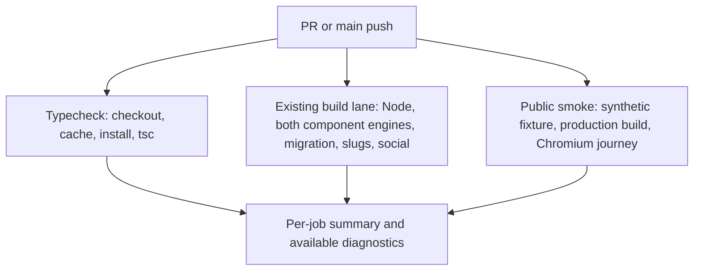
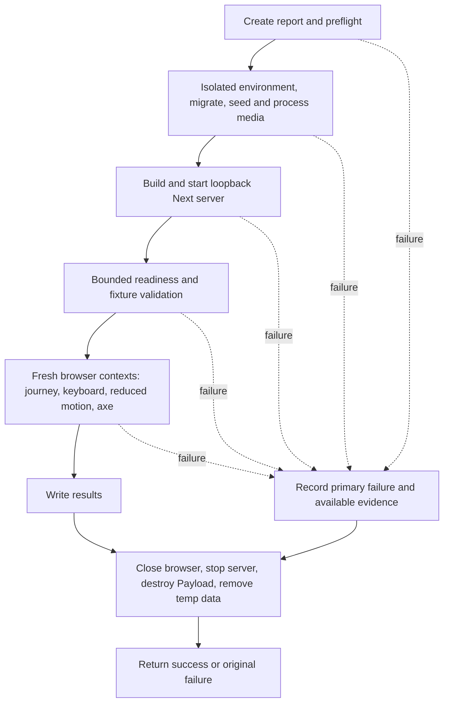

# Portfolio CI Feedback and Visitor Smoke - Plan

## Goal Capsule

- **Objective:** Maintainers get useful PR feedback earlier, can trust that visitors can explore a story and reach contact, and can diagnose failed checks from retained evidence.
- **Means:** Implement the selected balanced ideas 1–3 through independent CI checks, one seeded production visitor verifier, and bounded diagnostic artifacts (KTD1–KTD6).
- **Authority:** Product Contract owns behavior and scope; Planning Contract owns mechanisms within those requirements; units and examples implement them. `PRODUCT.md` and `DESIGN.md` remain the public-experience constraints.
- **Execution profile:** Configuration and production-smoke work; seek runtime proof of the fixture and journey before polishing reporting. Retain detailed existing tests.
- **Stop conditions:** Stop for evidence that a session-settled choice cannot work, an unavoidable dependency on live data, or an unresolved material defect. Runtime failures are investigation inputs, never permission to skip promised coverage.
- **Delivery owner:** The invoking autonomous delivery workflow implements, verifies, reviews, and opens the PR. This document authorizes no changes to production content.

---

## Product Contract

### Summary

Improve CI feedback, add a deterministic production visitor smoke, and retain useful failure evidence. Cover the selected balanced ideas 1–3 from the ideation report without expanding into its later proposals.

### Problem Frame

The current CI workflow makes typechecking wait behind FFmpeg provisioning and both browser component suites. Those suites replace Next links and images, so they cannot establish that the assembled production navigation works. Existing production verifiers cover runtime slugs and social metadata, but CI retains no diagnostic artifacts when a check fails.

The portfolio's intended outcome is that a visitor understands Carla, explores her work, and can contact her (`PRODUCT.md`, Product Purpose). A small real-page journey closes that integration gap while preserving the substantial regression coverage already present.

### Key Decisions

- **Take the balanced bundle.** (session-settled: user-directed — chosen over lean ideas 1+3 and extended ideas 4–6: close the real-navigation gap with a manageable maintenance cost.) Governs R1–R8.
- **Keep both existing browser engines.** (session-settled: user-approved — chosen over Chromium-only coverage: retain the existing Chromium and WebKit regression protection despite the extra setup cost.) Governs R3.

### Requirements

**Earlier feedback**

- R1. Typecheck must run without waiting for FFmpeg installation, browser installation, browser tests, or production builds; retain PR and main-push CI triggers.
- R2. Cache the pnpm store by lockfile and cancel superseded runs for the same PR, with explicit read-only repository token permissions and identifiable checks.
- R3. Preserve Node tests, media/FFmpeg coverage, migration checks, both Chromium and WebKit component suites, and the existing slug/social production verifiers with their post-build mutation guarantees.

**Real visitor protection**

- R4. A new production smoke must use synthetic, disposable SQLite and media fixtures to exercise actual Next navigation home → story → back to work → contact at widths 390 and 1440.
- R5. Include keyboard traversal, visible focus, reduced-motion behavior, and focused automated accessibility checks on the real public pages; do not claim full WCAG certification.
- R6. Fixtures and execution must be independent of local portfolio records, `/work/d`, secrets, and `.env` loading; missing prerequisites or incomplete mandatory scenarios fail explicitly.

**Failure diagnosis**

- R7. Retain failure screenshots and available traces, relevant command/server output, and JSON identifying the failed route, viewport, and step; capture failures before browser navigation as well.
- R8. Publish a short CI summary with check outcomes and unexpected skips, with bounded artifact retention rather than a separate reporting subsystem.

### Acceptance Examples

- AE1. **Covers R1–R3.** Given a PR with a type error, typecheck can fail while browser provisioning is still running, and a later update to the same PR cancels the superseded run without cancelling a different PR.
- AE2. **Covers R4–R6.** Given an empty disposable database, the verifier seeds the portfolio, opens a known story through a real rendered link, returns through Selected work, and finds the seeded email contact at both required widths. Keyboard and reduced-motion checks execute against that same synthetic portfolio.
- AE3. **Covers R7–R8.** Given a story-navigation assertion failure, CI fails and retains the screenshot, trace, route/viewport/step JSON, and logs. Given a build failure before a browser exists, CI still retains the build log and setup-failure report without inventing a screenshot.

### Success Criteria

The PR's check timeline shows the cheap typecheck independent of expensive setup, and the new smoke proves the portfolio's exploration-to-contact path. No particular speed percentage or total runner-minute reduction is required; record observed check durations without claiming an unmeasured improvement.

### Scope Boundaries

- Include only the selected ideation ideas 1–3 and changes needed to run and diagnose those checks.
- Keep `scripts/verify-public-navigation.mjs` as a local historical verifier; it is not the new CI entry point.
- Considered and not built: browser-binary/build caches, a large screenshot matrix, blanket performance gates, mutation testing, and standalone execution receipts. They add maintenance without evidence needed for this bounded outcome; revisit only for a demonstrated bottleneck or coverage defect.
- Preserve unrelated `.vitest-attachments/` and `src/components/__screenshots__/` content. The untracked ideation report is a session-generated product source, not pre-existing user code; carry its provenance into delivery review.

#### Deferred to Follow-Up Work

- Idea 4: sharing existing slug/social production lifecycle or builds; their environment contracts remain separate.
- Idea 5: report-first performance measurements and any subsequent gates.
- Idea 6: paired-volume recovery rehearsals.

---

## Planning Contract

### Assumptions

These are reversible engineering defaults selected without synchronous user confirmation, not additional product commitments.

- Use three CI lanes: isolated typecheck, existing Node/component/runtime regression coverage, and the new production smoke. Keep the legacy job ID `build` for the existing regression lane to reduce check-name migration risk.
- Use Chromium for the new visitor smoke. R3 keeps both engines for the existing component tests; it does not require multiplying the new journey into a cross-browser matrix.
- Seed one known story with three portrait images and one short synthetic video, plus a synthetic email. All four media belong to one pool, so random homepage ordering cannot change the available story or media set (`src/lib/homepage.ts`, `initialMediaCount`). Assertions do not depend on positions or random order.
- Use `@axe-core/playwright` as one development dependency, matching the installed Playwright types. Resolve its current compatible release during implementation and lock it in `pnpm-lock.yaml`.
- Retain diagnostics for seven days, subject to repository artifact policy. Use explicit allowlisted files, not uploads of the entire checkout or disposable database.

### Key Technical Decisions

- KTD1. **Independent jobs, limited duplication.** Implement R1–R3 using the three lanes above, with no dependency from typecheck to expensive jobs. Keep Node tests, Chromium components, WebKit components, migration, slugs, and social checks sequential within the existing `build` lane. This preserves ordering and avoids concurrent writes to `.next`; a larger per-engine/job matrix adds setup cost without timing evidence.
- KTD2. **Store caching and PR-scoped cancellation.** Configure the existing pnpm/setup-node action family for Node 22 and pnpm 10.34.6, enabling pnpm-store caching against `pnpm-lock.yaml` after pnpm is installed. Every lane still performs a frozen-lockfile install. Use a workflow plus PR-number/ref concurrency group with cancellation enabled only for PR events, and `contents: read` permissions. Main-push runs must not share cancellation groups with PR events. This follows GitHub's cache/concurrency guidance and fulfills R2 without caching `.next` or browser binaries.
- KTD3. **A dedicated production verifier owns its lifecycle.** Add `scripts/verify-public-smoke.ts` and expose `test:public-smoke`. Set disposable environment variables before dynamic Payload/config imports, following the existing slug/social pattern. Build once for this verifier and run one loopback Next server for its scenarios. Do not extract a common framework from the older verifiers: their separate build-time origins, state mutations, and cleanup are intentional retained contracts under R3 and R6.
- KTD4. **A non-vacuous fixture manifest.** Add a small smoke-local fixture helper returning the story slug/title, email, and media identities, rather than discovering whichever story happens to exist. Generate images with the already-installed Sharp and a tiny video with FFmpeg; process the uploaded video through the existing processing service before serving it. Assert the fixture's published image/poster/playback availability before the browser journey. Use geometry-relative scroll checks, not the historical script's fixed 500/1200px assumptions. Implements R4–R6.
- KTD5. **Small scenario set using actual interactions.** Use Playwright's existing standalone library, not a second test runner. Run the journey in fresh contexts at 390×844 and 1440×900, then a mobile reduced-motion context. Use semantic link locators, keyboard Tab/Enter for keyboard portions, and actual Next links for story entry; do not replace navigation with URL injection or DOM click evaluation. Wait on route, visible content, decoded media, and the existing readiness signal with deadlines rather than arbitrary sleeps. Run axe WCAG A/AA and 2.1 A/AA rules on settled home/story public pages, preserving raw results and reporting incomplete checks separately from violations. No blanket exclusions or baseline allowlist. Supports R4–R6; official Playwright and axe integration docs establish these APIs.
- KTD6. **Diagnostics survive failure without hiding it.** Persist a small report and command logs under `artifacts/ci/`; initialize reporting before setup. For each smoke context start Playwright tracing before navigation, retain the trace and viewport screenshot on failure, and discard successful traces. JSON records scenario, current phase/step, URL, viewport, motion mode, passed/failed/not-run checks, primary error, and any evidence-capture error. Capture console/page errors and relevant failed local requests alongside build/server logs. Cleanup and best-effort capture must preserve the primary failing exit. Existing browser suites contribute their available screenshots/attachments; do not claim traces they do not produce. Implements R7–R8.

These mechanisms are local, reversible additions using existing tools; no consequential storage/interface choice needs a bake-off.

### High-Level Technical Design

The job topology and verifier lifecycle describe different boundaries. Prose requirements control behavior if a sketch and text disagree.

**CI topology (KTD1–KTD2):**

**Owned lifecycle and failure path (KTD3–KTD6):**

### Behavior Trace and System-Wide Impact

Source-grounded trace: CI currently runs one `build` job; FFmpeg precedes dependency installation, Node tests, browser installation, both component suites, and finally typecheck. Both runtime scripts set their own database/media/origin before config import, migrate, build, mutate CMS state after build, start Next, and clean up in `finally`.

Public routes read Payload data through `src/lib/portfolio.ts`; the historical `projects` collection is configured by `src/collections/Photoshoots.ts`. Homepage composition ignores media without a photoshoot or usable presentation URL. Story galleries use real `next/link`, and the footer provides `/#work` and an optional `mailto:` link. `PublicMediaReadiness` waits for critical image settlement and a visible-page delay; image error settlement can still make it ready, so readiness alone cannot prove images loaded.

Maintainers see new check names and artifacts. Visitors should see no behavior change. No schema, auth, deployment, or shared runtime-harness change is needed. Source tracing establishes the data/navigation boundaries; precise runtime focus/animation timing remains execution evidence, not a planning claim.

### Risks and Dependencies

- **Build directory ownership:** All three production verifiers write `.next`. Run them sequentially when sharing a checkout; separate CI jobs have separate checkouts. Document the same constraint for local use.
- **Environment isolation:** Next loads environment files automatically. The new smoke preflight must detect the standard production `.env` filenames without reading their contents and stop before config/build if any are present; document use from a clean checkout/worktree. Set its generated secret, absolute database/media paths, loopback origin, production mode, and disabled automatic media jobs explicitly. Do not adopt this restriction for the preserved historical scripts.
- **Resource lifecycle:** Register cleanup as resources are acquired, including migration/fixture/build failures. Bound readiness and child termination, escalate server termination if needed, and preserve diagnostics outside disposable storage. Avoid a test-only recovery mode or automatic test retries.
- **Video readiness:** `src/collections/Media.ts` initially marks uploaded videos pending and public access requires derivatives. Use `runVideoProcessing` from `src/lib/media-processing/service.ts` against the current revision, then verify readiness. Missing FFmpeg/ffprobe fails the lane rather than downgrading the fixture.
- **Existing check protection:** Keep `build` as the existing job ID and inspect repository-required check names before renaming any display name. A repository setting change, if needed, belongs to delivery coordination, not silent workflow edits.
- **Duration:** A separate smoke adds one production build. Start with a 20-minute per-expensive-job timeout and tune only from actual evidence; typecheck should have its own shorter bound. No speed or runner-cost claim is established by this plan.

### Sources and Research

- Product source: `docs/ideation/2026-10-27-portfolio-ci-ideation.html`, selected ideas 1–3 and rejection summary. No brainstorm artifact exists; this Product Contract also captures the supplied conversation decisions.
- Existing patterns: `.github/workflows/ci.yml`, `package.json`, `vitest.config.ts`, `vitest.browser.config.ts`, `scripts/verify-photoshoot-slugs.ts`, `scripts/verify-social-metadata.ts`, and `scripts/verify-public-navigation.mjs`.
- Public behavior: `src/lib/homepage.ts`, `src/lib/portfolio.ts`, `src/components/PublicMediaReadiness.tsx`, `src/components/PortfolioFooter.tsx`, `src/app/(frontend)/page.tsx`, and `src/app/(frontend)/work/[slug]/page.tsx`.
- [GitHub dependency caching](https://docs.github.com/en/actions/reference/workflows-and-actions/dependency-caching) and [workflow concurrency](https://docs.github.com/en/actions/how-tos/write-workflows/choose-when-workflows-run/control-workflow-concurrency) support KTD2. [Artifact retention](https://docs.github.com/en/actions/tutorials/store-and-share-data) supports KTD6.
- [Playwright tracing](https://playwright.dev/docs/trace-viewer) and [accessibility testing](https://playwright.dev/docs/accessibility-testing) support KTD5–KTD6; [axe Playwright integration](https://github.com/dequelabs/axe-core-npm/tree/develop/packages/playwright) supports the tagged scan and raw-result choice.

---

## Implementation Units

### U1. Make cheap CI feedback independent

**Goal:** Deliver earlier type feedback while preserving all existing regression checks.

**Requirements:** R1–R3; Covers AE1.

**Dependencies:** None.

**Files:** Modify `.github/workflows/ci.yml`.

**Approach:**
1. Establish the typecheck lane and retained `build` lane per KTD1; add the smoke lane only when U2/U3 provide its command.
2. Apply KTD2 to dependency setup, permissions, and cancellation without changing the legacy verifier order or environment ownership.
3. Keep explicit FFmpeg/ffprobe preflights and both browser installations in the lanes that need them.

**Patterns to follow:** Existing action versions, Node/pnpm versions, FFmpeg retry/timeouts, and package scripts.

**Test expectation:** No new unit test for workflow syntax; validate the job graph and actual hosted checks.

**Verification scenarios:**
1. A PR typecheck starts independently of FFmpeg/browser setup and contains no browser or production-build prerequisite.
2. Both lockfile cache hit and miss still perform the frozen install.
3. Updating one PR supersedes its prior run, while another PR and main-push runs remain independent.
4. Both component engines, Node/media tests, migration, and both existing production verifiers remain visible and gating.

**Verification:** Workflow validation and the PR check timeline demonstrate R1–R3. Preserve branch-protection compatibility rather than assuming the job ID alone proves the external check name.

### U2. Add the isolated seeded production lifecycle

**Goal:** Provide a reliable production environment for the visitor assertions.

**Requirements:** R4, R6, R7.

**Dependencies:** None; U1 can proceed independently.

**Files:** Create `scripts/verify-public-smoke.ts`, `scripts/public-smoke-fixture.ts`, and `scripts/public-smoke-fixture.test.ts`; modify `package.json` and `.gitignore` for the new command and owned `artifacts/ci/` output.

**Approach:**
1. Implement KTD3/KTD4 with a small smoke-local helper and explicit fixture manifest.
2. Enforce the environment preflight and lifecycle constraints above, using the historical runtime verifiers as patterns rather than changing them.
3. Initialize KTD6 reporting before setup and leave the browser scenario entry point for U3.

**Patterns to follow:** Existing temporary directory, dynamic config imports, migration, loopback server, and Payload cleanup; Sharp fixture upload in `scripts/verify-social-metadata.ts`; media processing service and task.

**Execution note:** Prove that a clean checkout can seed, build, and serve the manifest before adding the full browser assertions.

**Test scenarios:**
1. Fresh fixture creation yields the known story, seeded email, three public images, and a ready video with valid poster/playback derivatives; manifest references match persisted relationships.
2. Existing production `.env` filenames cause preflight failure before Payload/build is invoked, without reading or printing their contents.
3. Missing media tools, migration/build failure, or early server exit produces a failing report with the current setup step and relevant output.
4. Failure after acquiring Payload/server resources still terminates owned resources and removes disposable data while retaining diagnostics.

**Verification:** Put focused preflight/lifecycle failure tests in the named test file where seams exist; verify fixture correctness through the real public smoke, not a duplicate mocked CMS suite. No local database/media paths are touched.

### U3. Prove the visitor journey, keyboard access, and reduced motion

**Goal:** Protect the assembled public experience at the two selected widths.

**Requirements:** R4–R7; Covers AE2.

**Dependencies:** U2.

**Files:** Extend `scripts/verify-public-smoke.ts`; add the accessibility dependency to `package.json` and `pnpm-lock.yaml`. The verifier itself is the production integration test file.

**Approach:**
1. Implement KTD5 scenarios against the fixture manifest, recording steps through KTD6.
2. Verify story heading and successful media load independently of readiness, then return via the real Selected work link and confirm its target is visible.
3. Exercise keyboard navigation to story, return, and Email using bounded Tab traversal and Enter where navigation stays local; inspect the email target without opening a mail client.
4. Test reduced motion on a fresh mobile context before first navigation and run focused axe scans after the public surfaces settle.

**Patterns to follow:** Historical navigation verifier's route/readiness checks and reduced-motion intent; real footer and story semantics. Do not carry over fixed delays, `/work/d`, sitemap discovery, or exact scroll coordinates.

**Test scenarios:**
1. Covers AE2. At each required width the home story link opens the fixture heading at the top, the gallery contains loaded fixture media, Selected work returns to the visible work section, and Email exposes the seeded `mailto:` value.
2. At each width, bounded Tab traversal reaches the journey links with visible, unobscured focus; Enter activates local navigation and focus remains usable after route changes. Assert focus styling as well as element identity and visibility.
3. The video can acquire/play normally after readiness and scrolling it into view; in the fresh reduced-motion context its poster loads but video source acquisition/autoplay remain suppressed, and the navigation/contact journey stays usable.
4. Settled home and story pages have zero violations for the selected axe tags. Preserve violations and incomplete results in JSON; a scan error is a failed check, not a clean result.
5. A missing link, broken fixture image, absent email, or readiness deadline causes a named failure rather than an unexpected pass or silent skip.

**Verification:** `test:public-smoke` passes in the production environment, reports all mandatory scenarios, and uses the actual Next link/image implementations. If it reveals a real public-page defect, make the narrowest correction with an appropriate existing component test; do not relax the smoke or broaden into redesign work.

### U4. Retain evidence and document how to use it

**Goal:** Let maintainers diagnose a failed run without reconstructing the runner state.

**Requirements:** R7–R8 and preservation under R3; Covers AE3.

**Dependencies:** U1, U2, U3.

**Files:** Modify `.github/workflows/ci.yml`, `scripts/verify-public-smoke.ts`, and `README.md`; create `scripts/public-smoke-report.test.ts` for report/error-preservation behavior. Modify `vitest.browser.config.ts` only if needed to expose existing failure screenshot output. Keep existing runtime verifier implementations intact.

**Approach:**
1. Complete KTD6 capture and make each CI test command retain its console output without losing its exit code.
2. Add per-job failure artifact uploads for owned logs/JSON, smoke screenshots/traces, and available component failure images/attachments. Hidden Vitest attachment directories need explicit allowlisting and upload support; do not broadly enable hidden checkout uploads.
3. Write short job summaries even on failures using actual step results. Distinguish failed prerequisites, expected downstream not-run steps, unexpected skips, and successful checks; summarize report contents without adding a second reporting program.
4. Document the new command, clean-checkout requirement, shared `.next` constraint, fixture ownership, evidence locations, and trace viewing. Integrate the smoke job into CI.

**Execution note:** Inspect one controlled failing assertion and one pre-browser setup failure locally; restore the healthy implementation before delivery. This is a bounded diagnostic check, not a mutation framework.

**Test scenarios:**
1. Covers AE3. A browser assertion failure retains a readable screenshot/trace and JSON with route, viewport, and step, plus logs; CI stays red.
2. A build failure still writes a failed setup report and retains command output, without claiming browser evidence exists.
3. Screenshot/trace capture failure is a secondary diagnostic and does not replace the assertion error or produce success.
4. A successful run discards bulky traces and emits a concise complete summary; mandatory not-run smoke scenarios cannot be reported as passed.
5. A component-suite failure uploads its existing available evidence, and slug/social command failures retain command/server output without changing the tests' behavior.

**Verification:** Inspect retained files locally and downloadable PR artifacts. The workflow remains failing when any required test fails, regardless of artifact capture success.

---

## Verification Contract

Commands below are the executor's verification targets, not evidence that planning executed them. Production verifiers must not run concurrently in one checkout.

| Check | Applies to | Required outcome |
|---|---|---|
| `pnpm typecheck` | U1–U4 | Passes independently in CI; no FFmpeg/browser setup prerequisite. |
| `pnpm test` | U2/U4 helpers and retained Node/media coverage | Existing tests and focused new failure-path tests pass with FFmpeg/ffprobe present. |
| `pnpm test:browser` | Retained component coverage | Chromium suite remains gating and preserves available diagnostics on failure. |
| `pnpm test:browser:webkit` | Retained component coverage | WebKit suite remains gating. |
| `pnpm exec payload migrate` | Existing migration gate | Existing workflow migration step remains successful against disposable CI storage. |
| `pnpm test:slugs` | Runtime compatibility | Post-build create/rename and 404 behavior remain covered. |
| `pnpm test:social-metadata` | Runtime compatibility | Post-build social image update/replace/clear behavior remains covered. |
| `pnpm test:public-smoke` (new) | U2–U4 | Required journey, keyboard, reduced-motion, and tagged accessibility checks pass against production Next and synthetic data. |
| Workflow validation and hosted PR checks | U1/U4 | Cache/cancellation/job topology and diagnostic upload work on GitHub; no swallowed failure exits. |

Check the controlled-failure cases in U4 before shipping and remove any temporary fault. A separate generic build check is unnecessary: the production verifiers already build, and the new smoke owns an additional build. No `release:validate` script or behavioral skill evaluation exists for this change.

---

## Definition of Done

- U1 meets AE1 with the retained regression gates visible in CI.
- U2 serves only its disposable synthetic manifest and preserves lifecycle failures.
- U3 meets AE2 without mocked Next behavior or silent mandatory skips.
- U4 meets AE3 with inspectable artifacts and short summaries.
- Required local verification and hosted PR checks pass; report actual durations separately from any claims about improvement.
- Remove abandoned implementation attempts and deliberate-failure probes from the final diff.
- Review the diff against R1–R8, preserve unrelated user artifacts, and include the ideation source with accurate session provenance in the delivery PR.
